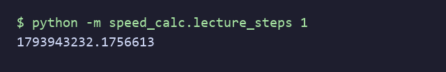
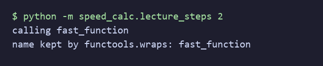
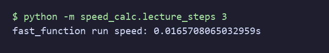
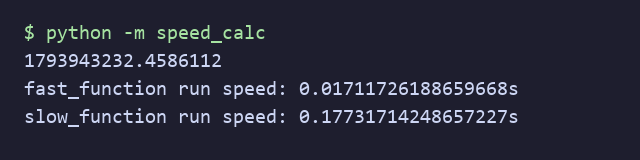

# ⏱️ Speed Calc Decorator

A Python decorator that measures how many seconds a function takes to run. It is
my solution to a lecture exercise from Udemy's *100 Days of Code: The Complete
Python Pro Bootcamp*, written for fellow course participants and for anyone
browsing for ideas. It has no runtime dependencies.

## 📚 Table of Contents

- [Overview](#-overview)
- [Requirements](#-requirements)
- [Setup](#-setup)
- [Run](#-run)
- [Lecture steps](#-lecture-steps)
- [Tests](#-tests)
- [Documentation](#-documentation)
- [License](#-license)
- [Links](#-links)
- [Appendix: Project documents](#-appendix-project-documents)

## 🧭 Overview

The assignment: write `speed_calc_decorator` and use it to print how long
`fast_function` and `slow_function` take. Expected output has this shape:

```text
1695050908.1985211
fast_function run speed: 0.33974480628967285s
slow_function run speed: 2.9590742588043213s
```

The numbers differ on every machine. The repository is laid out as:

| Folder | Purpose |
| --- | --- |
| `src/speed_calc/` | The package: the decorator, the two demo functions, `constants.py` |
| `tests/` | pytest tests; they use a fake clock, so they never depend on real time |
| `docs/` | Project documents (Business Case, plan, milestones), screenshots and the wiki |

## 📋 Requirements

- Python 3.13 or newer (`python --version`).
- `git`, to clone the repository.
- Optional: [Doxygen](https://www.doxygen.nl/) to build the API documentation.

There are no runtime dependencies. `pytest` is needed only to run the tests.

## 🛠️ Setup

Create a local virtual environment named `.venv` in the project folder and
activate it. Windows (PowerShell):

```powershell
python -m venv .venv
.venv\Scripts\Activate.ps1
```

Linux and macOS:

```bash
python3 -m venv .venv
source .venv/bin/activate
```

Upgrade pip, then install the project with the test tools:

```bash
python -m pip install --upgrade pip
python -m pip install -e ".[dev]"
```

Leave the environment with `deactivate`. Delete the `.venv` folder to start over.
The `.venv` folder is ignored by git.

## ▶️ Run

With the environment active:

```bash
python -m speed_calc
```

It prints the current time, then the run time of `fast_function` and
`slow_function`. The values depend on your machine.

## 🪜 Lecture steps

Each step runs on its own with `python -m speed_calc.lecture_steps N` (N is 1 to
4); step 4 is the same as `python -m speed_calc`. The screenshots are rendered
from the real output of each command by
[`docs/screenshots/generate_screenshots.py`](./docs/screenshots/generate_screenshots.py).

### Step 1: the current time

`time.time()` returns the seconds since January 1st, 1970.



### Step 2: the decorator skeleton

A decorator takes a function and returns a wrapper that calls it. `functools.wraps`
keeps the original name.



### Step 3: timing the call

The wrapper reads the clock before and after the call and prints the difference.



### Step 4: fast against slow

`@speed_calc_decorator` above `fast_function` and `slow_function` gives the
expected output.



## 🧪 Tests

```bash
python -m pytest
```

All tests pass; they use a fake clock, so they do not depend on how fast your
machine is.

## 📖 Documentation

The source uses Doxygen comments. Build the HTML documentation into
`docs/doxygen/`:

```bash
doxygen Doxyfile
```

## 📄 License

GNU Affero General Public License v3.0, see [LICENSE](./LICENSE).

## 🔗 Links

- [Repository][repository]
- [Wiki][documentation]
- [Issue tracker][issues]

## 📎 Appendix: Project documents

| Document | What it tells you |
| --- | --- |
| [AGENTS.md][agents] | The rules AI agents follow in this repository |
| [Business Case][BC-001] | Why the project exists, its scope and success criteria |
| [Stakeholder Analysis][SA-001] | Who is involved; the stakeholder IDs used for owners and reviewers |
| [Project Plan][PP-001] | The gateways and their schedule |
| [Milestones][milestones] | One document per gateway: Go/No-Go criteria and tasks |
| [Artifact registry][registry] | Where each artifact type lives, the next version, the PO language and domain |
| [Traceability matrix][TM-001] | How the artifacts link and when each was last reviewed |
| [Framework README][framework-readme] | The framework this project uses |
| [Framework changelog][framework-changelog] | What changed in each framework release |

---

[repository]: https://git.tirsystem.com/Tirsvad-Udemy-100-days-of-code/054-speed-calc-decorator
[documentation]: https://git.tirsystem.com/Tirsvad-Udemy-100-days-of-code/054-speed-calc-decorator/wiki
[issues]: https://git.tirsystem.com/Tirsvad-Udemy-100-days-of-code/054-speed-calc-decorator/issues
[agents]: ./AGENTS.md
[BC-001]: ./docs/business-case.md
[SA-001]: ./docs/stakeholder-analysis.md
[PP-001]: ./docs/project-plan.md
[milestones]: ./docs/milestones/
[registry]: ./docs/artifact-registry.md
[TM-001]: ./docs/sqa/traceability-matrix.md
[framework-readme]: ./framework/README.md
[framework-changelog]: ./framework/CHANGELOG.md
