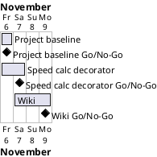

# Project Plan

## Metadata
| Key | Value |
| --- | --- |
| ID | PP-001 |
| CrossReference | [BC-001], [SA-001], [MIL-001], [MIL-002], [MIL-003] |
| Language | en |
| Domain | it |

## Version History
| Date | Status | Author | Reviewer | Change | Commit |
| --- | --- | --- | --- | --- | --- |
| 2026-11-06 | Deprecated | Jens Tirsvad Nielsen | S01 | Initial version | [a07d05b] |
| 2026-11-06 | Accepted | Jens Tirsvad Nielsen | S01 | Informal review against QC-PP-001 fixed 7 defects (constants.py gateway, No-Go rule, sources, risk trace, stories, sync mark); accepted by S01 as Product Owner through the accepted plan in chat on 2026-11-06 | [a07d05b] |

---

## Purpose

This plan schedules three gateways that take the lecture-054 exercise from an
empty repository to a tested, documented solution with a three-language wiki,
within the Business Case constraint of finishing by 2026-11-09.

## Planning Assumptions

- The plan starts 2026-11-06 and ends by 2026-11-09 (source: [BC-001] Constraints, target 2026-11-09).
- Phase length: one working session per gateway (source: the author, from the scope of [BC-001]).
- One branch and one pull request per gateway, so that the steps stay traceable.
- Stakeholder S01 owns and reviews every gateway ([SA-001]).

## Gateway Schedule

| Gateway | Document | Window | Decision date | Owner | Stories | Main deliverable | Milestone |
| --- | --- | --- | --- | --- | --- | --- | --- |
| Project baseline and repository | [MIL-001] | 2026-11-06 | 2026-11-06 | S01 | none (technical tasks, see ADR-0001) | Project configuration, README, Doxyfile, ADR-0001, repository metadata | not yet synced |
| Speed calc decorator | [MIL-002] | 2026-11-06 to 2026-11-07 | 2026-11-07 | S01 | none (technical tasks, see ADR-0001) | Working package, tests, one screenshot per lecture step | not yet synced |
| Wiki in three languages | [MIL-003] | 2026-11-07 to 2026-11-09 | 2026-11-09 | S01 | none (technical tasks, see ADR-0001) | Wiki pages in en, da, ms explaining each lecture step | not yet synced |



## Scope Coverage

| Business Case scope item | Gateway |
| --- | --- |
| `pyproject.toml`, `.gitignore`, `Doxyfile` | [MIL-001] |
| `constants.py` | [MIL-002] |
| README with venv and test instructions | [MIL-001], updated in [MIL-002] |
| Repository description and topics | [MIL-001] |
| Python package under `src/`, tests under `tests/` | [MIL-002] |
| One screenshot per lecture step | [MIL-002] |
| Wiki in en, da, ms | [MIL-003] |

## Dependencies

```
MIL-001 → MIL-002 → MIL-003
```

A No-Go stops the later gateways; their dates move by the same number of days.
S01, as Product Owner, decides whether the end date of 2026-11-09 moves; a move
beyond it changes the constraint in [BC-001] and needs a new version of it.

## Plan Risks

| Risk | Impact | Mitigation |
| --- | --- | --- |
| The wiki is not enabled on the git host (assumption of [BC-001]) | MIL-003 cannot be published | Task checks the setting early; stop and report if disabled |
| Screenshots need a rendering tool (relates to the screenshot risk of [BC-001]) | Delay in MIL-002 | Render from captured output with a dev-only tool, no host desktop |
| Timing tests are flaky (risk of [BC-001]) | False failures in MIL-002 | Tests inject a fake clock; checked by Go criterion 1 of [MIL-002] |
| The token in `.env` leaks (risk of [BC-001]) | Account compromise during MIL-001 | `.env` is git-ignored; checked by Go criterion 2 of [MIL-001] |

## Open Issues

- The request names the repository `Tirsvad-Udemy-100_days_of_code`, but `origin`
  is `Tirsvad-Udemy-100-days-of-code/054-speed-calc-decorator`. The plan uses
  `origin`.
- User stories and use cases are skipped: the exercise is one function with no
  user interaction. The reason is recorded in ADR-0001 (task in [MIL-001]).
- Under autonomous mode the reviews of S01's documents are performed by the AI
  as stand-in for S01 and are recorded as not independent.

---

[BC-001]: ./business-case.md
[SA-001]: ./stakeholder-analysis.md
[MIL-001]: ./milestones/mil-001-project-baseline.md
[MIL-002]: ./milestones/mil-002-speed-calc-decorator.md
[MIL-003]: ./milestones/mil-003-wiki-and-screenshots.md
[a07d05b]: https://git.tirsystem.com/Tirsvad-Udemy-100-days-of-code/054-speed-calc-decorator/commit/a07d05b385e6b831b90731aefe08f078ebb951ca
